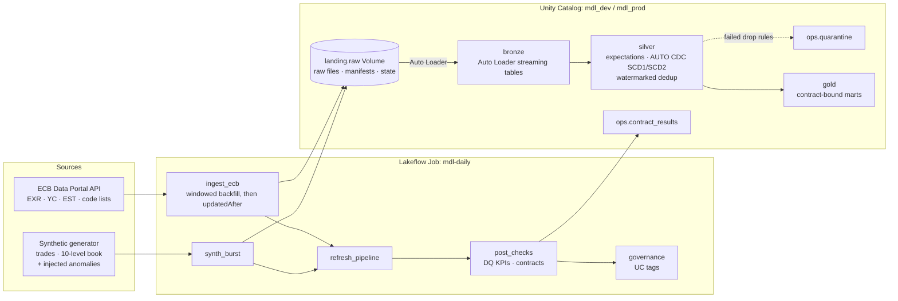
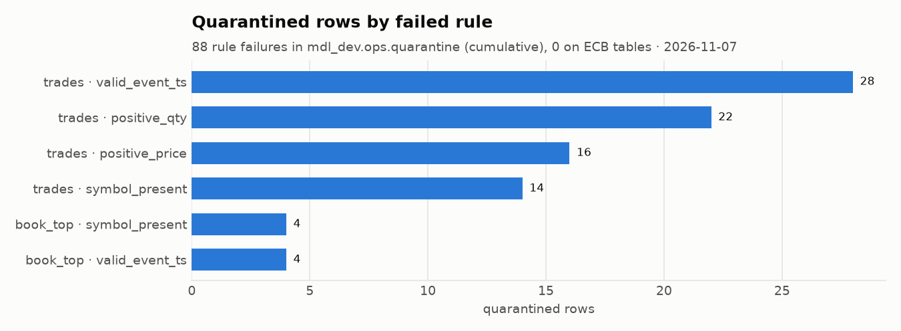
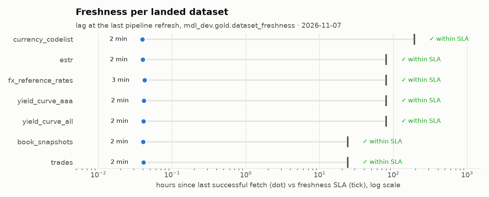
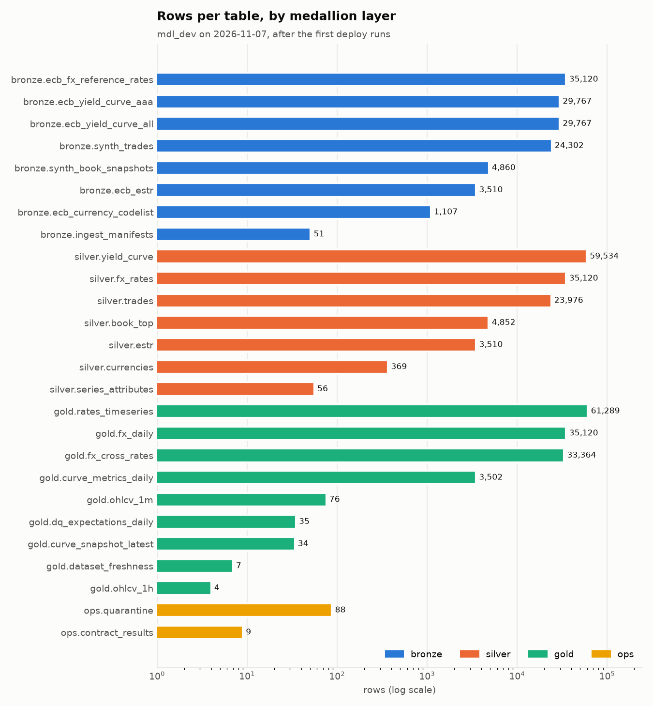
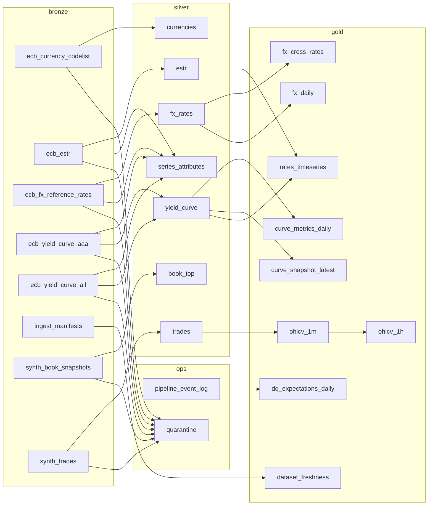

# market-data-lakehouse

A production-style market data lakehouse on **Databricks Free Edition**. It ingests
euro FX reference rates, euro area yield curves and €STR from the ECB, plus a
synthetic tick and order-book stream. Data flows through a bronze/silver/gold
medallion on Delta Lake with Lakeflow Declarative Pipelines, Lakeflow Jobs,
Unity Catalog governance and Declarative Automation Bundles (formerly Asset
Bundles).

Everything ran end to end on a Free Edition workspace: a 2020-to-today ECB
backfill, 9 gold marts that pass their data contracts, and 0 ECB rows
quarantined. The interesting parts are the [design decisions](#design-decisions)
and the [bugs the platform and the data caught](#bugs-found-along-the-way).

- Data sources and their reuse terms: [DATA.md](DATA.md). **No data is stored in this repository.**
- Governance (roles, grants, tags, contracts, lineage): [docs/governance.md](docs/governance.md)
- What Free Edition allows, as probed: [docs/step0-probe.md](docs/step0-probe.md)

## Architecture



**One serverless Lakeflow pipeline** (triggered, CURRENT channel) holds all layers:

| Layer | Tables | Highlights |
|---|---|---|
| bronze | `ecb_*` (5), `synth_trades`, `synth_book_snapshots`, `ingest_manifests` | Auto Loader on a UC Volume; all columns kept as raw strings; `_source_file`, `_file_modified_at`, `_ingest_ts`; append-only |
| silver | `fx_rates`, `yield_curve`, `estr` | typed with `try_cast` (bad values become NULL and the rules catch them); **AUTO CDC SCD1** keyed by `(series_key, obs_date)`, sequenced by file time, so ECB revisions and late data replace older versions |
| silver | `currencies`, `series_attributes` | **AUTO CDC SCD2** history of reference data (names, titles, units) |
| silver | `trades`, `book_top` | `dropDuplicatesWithinWatermark` on `event_id` (10 min); top-of-book metrics from 10-level snapshots |
| ops | `quarantine` | one table, an append flow per source; failed rule names, the record as JSON, lineage columns |
| gold | `fx_daily`, `fx_cross_rates`, `rates_timeseries`, `curve_snapshot_latest`, `curve_metrics_daily`, `ohlcv_1m`, `ohlcv_1h`, `dataset_freshness`, `dq_expectations_daily` | one [data contract](src/mdl/contracts) each; `ohlcv_1m` is a watermarked streaming aggregate, the rest materialized views |

The transforms are plain DataFrame functions in `src/mdl/transforms`. The
pipeline files in `lakeflow/` are thin declarations around them, so the same
code is unit tested locally and runs in the pipeline.

## Data quality

Rules are data (`src/mdl/quality.py`): each is a SQL constraint with an
action, `warn`, `drop` (also sent to quarantine) or `fail`. Two details matter:

* A constraint that evaluates to NULL is dropped by `expect_or_drop` but would
  slip past a naive `NOT(rule)` quarantine filter. Quarantine therefore uses
  `coalesce(rule, false)` for every rule, so each rejected row lands in
  exactly one place.
* Each rule checks one concern and lets NULL through unless NULL is the
  concern, so one bad value counts against one rule and the KPIs stay meaningful.



The synthetic generator injects malformed events at a known rate and keeps
the ground truth outside the payload. Every injected malformed trade was
quarantined. In one run, trades reconcile exactly: 12,151 delivered − 123
duplicates − 40 quarantined = 11,988 in silver. ECB data had no rule
failures. Per-rule pass rates per day (from the pipeline event log) are in
`gold.dq_expectations_daily`. The warn-only rule `not_late` flags late
synthetic trades (99.3% pass) without dropping them.

## Freshness

Every landed batch, including an empty "no new data" answer, writes a
manifest (request, HTTP status, SHA-256, rows, period range).
`gold.dataset_freshness` compares the last successful fetch with an SLA per
dataset: 80 h for ECB series, which covers a weekend, and 24 h for the
synthetic stream.



## Volumes



ECB counts reconcile across layers (FX 35,120 in bronze, silver and gold;
curves 2 × 29,767 = 59,534; €STR 3,510). The figures are rendered in light
mode, and every bar carries its table name and count, because two layer
colors fall below 3:1 contrast on the light surface (palette validator WARN).

## Unity Catalog

* **Layout:** one catalog per environment, one schema per layer, and a managed Volume as the landing zone.
* **Roles:** service principals `mdl-pipeline` (writes; prod runs as it) and `mdl-analyst` (reads gold). Grants are bundle resources. Free Edition rejects workspace groups as grantees, see [docs/governance.md](docs/governance.md).
* **Tags:** `layer`, `source`, `license`, `pii`, `domain`, `contract`, plus a `role=primary_key` column tag. They're applied idempotently after every update.
* **Comments:** every table has one. Gold column comments come from the contracts.
* **Lineage:** recorded by Unity Catalog. The graph below is generated from `system.access.table_lineage` (dev).



## Orchestration

Job `mdl-daily-<target>`, weekdays at 17:30 Europe/Berlin, after the ECB
publishes its reference rates. The schedule is paused in dev.

```
ingest_ecb ─┐
            ├─> refresh_pipeline ─> post_checks ─> governance (run_if: ALL_DONE)
synth_burst ┘
```

* **ECB ingestion:** on an empty landing zone it backfills from 2020-01-01 in
  one-year windows, at most 8 per run, with a resumable cursor in
  `_state/`. Afterwards each run requests `updatedAfter`, anchored at the
  backfill start, so revisions published during the backfill are not missed.
  "No new data" from the ECB arrives as HTTP 404 with an SDMX body and is
  recorded as an empty batch.
* **`post_checks`:** writes `gold.dq_expectations_daily` from the event log,
  checks all 9 contracts, and fails the run on a violation. It is idempotent
  per job run, which matters because serverless retries failed tasks on its
  own (see bugs below).

## Repository layout

```
src/mdl/         package: sources (ECB, landing, HTTP), synth, transforms (bronze/silver/gold),
                 quality, contracts (+ YAML), checks, governance, lakeflow helpers, thermal guard
lakeflow/        Lakeflow Declarative Pipeline sources (thin; call mdl.transforms)
jobs/            job task entry points (ingest, post_checks, governance, serverless pytest)
resources/       bundle resources: UC schemas/volume/grants, pipeline, jobs
databricks.yml   bundle: dev and prod targets (no host: it comes from the CLI profile)
scripts/         UC bootstrap, service principals, charts, secret check, CI workspace stub
tests/           pytest (in memory on Windows; files and Delta in CI and on Databricks)
docs/            governance, Free Edition probe results, figures
```

## Run it yourself

Requirements: Python 3.12, JDK 21 (Temurin), the Databricks CLI, and a
Databricks Free Edition workspace.

```bash
python -m venv .venv
.venv/Scripts/python -m pip install -e ".[spark,dev]"   # .venv/bin/python on Linux/macOS
git config core.hooksPath .githooks                      # pre-commit secret check
cp .env.example .env                                     # local-only values
ruff check . && ruff format --check . && mypy && pytest

databricks auth login --host https://<workspace-host> --profile mdl    # OAuth, once
python scripts/uc_bootstrap.py  --profile mdl --env dev                # create mdl_dev (SQL)
python scripts/uc_principals.py --profile mdl --env dev                # service principals + USE CATALOG
databricks bundle deploy -t dev -p mdl
databricks bundle run daily -t dev -p mdl
databricks bundle run tests -t dev -p mdl                              # file-I/O and Delta tests on serverless
```

For prod, the deploying user also needs `servicePrincipal.user` on
`mdl-pipeline` (`uc_principals.py --grant-deployer`). Then run
`bundle deploy -t prod`.

## Testing

| Where | What runs | Why |
|---|---|---|
| Windows laptop | the unit suite, Spark DataFrames built in memory | Spark cannot even list local files on Windows without Hadoop's `winutils`, which this project does not install |
| GitHub Actions (Linux) | everything, on **pyspark 4.1 and 4.2** | pipelines run Spark 4.1 (Runtime 18.3, CURRENT channel), jobs run Spark 4.2 (serverless env 6) |
| Databricks dev (`mdl-tests` job) | the `delta` and `localfs` tests on serverless (9 pass in 78 s) | proves Delta MERGE, time travel, schema evolution and file metadata before any push |

CI also runs ruff, strict mypy, a secret scan, and `databricks bundle validate
--strict` for both targets. Validation runs against `scripts/stub_workspace.py`,
a small local stand-in for the endpoints the CLI calls, so **CI needs no
workspace and no secret**.

## Cost and compute notes

Free Edition has no bill: usage is capped by a daily fair-use quota, and
exceeding it shuts compute down until the next day. All compute here is
serverless.

| Run (dev) | Wall time |
|---|---|
| Daily job, incremental (5 tasks) | 5.5 min: ingest 50 s, synth 44 s, pipeline 193 s, post_checks 85 s, governance 35 s |
| Pipeline full refresh (all tables from the landing files) | 3.5 min |
| First run with the 2020-to-today ECB backfill | 9 min |
| Serverless test job (9 Delta and file tests) | 2 min |

* About 2 minutes of each pipeline update is serverless startup and table
  setup. One triggered pipeline per environment, never `continuous`, keeps the
  quota for actual work.
* The backfill runs in one-year windows (7 requests per dataset). The cursor
  lets a longer history be spread over several runs.
* `system.billing.usage` had no rows on the day of these runs, so DBU figures
  are not quoted. Use `SELECT * FROM system.billing.usage` once it fills.
* No run hit a quota warning: no WARN or ERROR events in the pipeline event log.

## Free Edition limits that shaped the design

* **Serverless only**, one 2X-Small SQL warehouse, at most 5 concurrent job
  tasks, and a fair-use quota. The job peaks at 2 concurrent tasks.
* **"One active pipeline per type".** Two triggered pipelines did update at
  the same time in the probe; runs are still kept sequential.
* **Default Storage catalogs:** the REST API (and the bundle `catalogs`
  resource) cannot create catalogs, only SQL can, hence `scripts/uc_bootstrap.py`.
* **No account console and no SCIM:** workspace groups are not UC grantees,
  so roles are service principals.
* **Outbound internet is limited** to unlisted "trusted domains". The ECB API
  was reachable from serverless. The CLI also supports ingesting locally and
  uploading to the Volume.
* **Non-commercial use only.** This is a portfolio project.

## Design decisions

* **Environments by catalog, not by schema prefix.** `mode: development`
  prefixes every schema with `dev_<user>_`, so the dev target sets the presets
  it needs (pipeline development mode, paused triggers) without that mode.
* **Code matches the runtime versions.** Local Python 3.12 and pyspark 4.2.0
  match serverless env 6. CI also tests pyspark 4.1 for the pipeline runtime.
  The pipeline files rely only on the APIs both versions have.
* **ECB terms built in.** Bronze keeps every payload byte for byte, with a
  SHA-256 in the manifest. Gold carries ECB values unchanged, and derived
  measures (crosses, slopes, bars) are separate named columns and tagged
  `derived`. The US Treasury curve was left out for lack of clear reuse terms
  (see [DATA.md](DATA.md)).
* **No secrets or workspace identifiers in git.** The host lives in the CLI
  profile only; ids are resolved at deploy time. A pre-commit and commit-msg
  hook blocks workspace hosts, tokens, e-mail addresses and the literals
  listed in a git-ignored `.env`.

## Bugs found along the way

Each one was caught by a test, a reconciliation, a contract or the platform,
then fixed and covered by a test:

1. **Silver lost 41% of synthetic trades.** Event ids restarted with every
   burst, so the second burst was deduplicated away as "duplicates". Caught by
   reconciling bronze against silver counts. Ids now embed the burst start,
   and a test asserts uniqueness across bursts.
2. **Negative freshness lag.** Synthetic manifests were stamped with simulated
   event time, which can lie ahead of the wall clock. Caught by the
   `non_negative_lag` rule in the `dataset_freshness` contract, which failed
   the job. Manifests now record the write time.
3. **`post_checks` ran twice in one run.** Serverless auto-optimization
   retries a failed task even without `max_retries` (attempt 1 in the run
   API). Contract results were appended, so a retry would duplicate them. They
   are now MERGEd on `(job_run_id, contract)`, and a Delta test proves a retry
   changes nothing. Retries stay on: a later run showed one rescuing a
   transient "library installation" failure.
4. **NULL-unsafe quarantine.** Rows whose rule evaluated to NULL would have
   vanished from both the clean table and quarantine. The fix is
   `coalesce(rule, false)` per rule, tested.
5. **Editable installs don't import on serverless.** `--editable` dependencies
   install without error but `import mdl` fails, so jobs and the pipeline
   install the project folder normally.
6. **`delta-spark` as a serverless dependency breaks environment setup.** It
   pins pyspark, which conflicts with the Spark Connect client. The runtime's
   own Delta is used instead.
7. **A Delta test that had never run was wrong.** It expected an `APPEND`
   history operation, but Delta records a DataFrame append as `WRITE` in Append
   mode. Fixed when the test was first made to run (serverless test job).
8. **`bundle validate` needs a live workspace,** even with a dummy token. CI
   validates against a local stub instead.
9. **Platform constraints** found while deploying: catalogs only via SQL,
   dev-mode schema prefixes, groups not grantable, and prod `run_as` requiring
   `servicePrincipal.user`. See [docs/step0-probe.md](docs/step0-probe.md).

## License

MIT, see [LICENSE](LICENSE). Data sources keep their own terms, see [DATA.md](DATA.md).
Source: ECB statistics.
